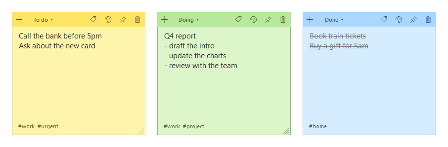

# StayFocus Notes

Sticky notes for the Windows desktop that appear and disappear with one keyboard shortcut, with a backlog board and tags to keep track of what you are doing.



- **One shortcut to show or hide every note** — `Ctrl+Alt+N`
- **Backlog board** — all notes in four columns: To do, Doing, Done, Archive
- **Tags** — label notes, filter the board by tag
- **Private by design** — no internet access, no account, no telemetry; notes stay in one file on your PC
- **Small** — a single ~110 KB program, nothing to install, no administrator rights


## Install

Requires Windows 10 or 11.

1. Download `StayFocusNotes.zip` from the [latest release](https://github.com/mfessalifi/stayfocus/releases/latest).
2. Unzip it and put `StayFocusNotes.exe` in a folder of your own, for example `Documents\StayFocusNotes`.
3. Double-click `StayFocusNotes.exe`. A welcome note appears and a note icon is added to the tray (bottom-right of the taskbar).

**Windows may warn "Windows protected your PC"** the first time. This happens because the program is not signed with a commercial certificate. Choose **More info → Run anyway**, or [build it yourself](#build-from-source) from the source in this repository. Each release is built by GitHub from this source, and comes with a `SHA256SUMS.txt` file you can check the download against:

```powershell
Get-FileHash StayFocusNotes.zip -Algorithm SHA256
```

To start it automatically when you sign in, right-click the tray icon and tick **Start with Windows**.

## Use

| Action | How |
|---|---|
| Show / hide all notes | `Ctrl+Alt+N`, or click the tray icon |
| New note | `Ctrl+Alt+Shift+N`, or the `+` on any note |
| Open the backlog board | `Ctrl+Alt+B` |
| Move a note | drag its top bar |
| Resize a note | drag an edge or the bottom-right corner |
| Change status | the `To do ▾` button on the note, or drag its card to another column on the board |
| Tags | the tag button on the note, or right-click a card on the board |
| Color, always on top, delete | the buttons on the right of the note's top bar |

Notes save automatically as you type.

### Status

- **To do / Doing** — normal notes on your desktop.
- **Done** — stays on the desktop with its text struck through.
- **Archive** — leaves the desktop and is kept on the board only. Move it to another column to bring it back.

### Tags

A tag is one word (letters, digits and `- _ . / +`, up to 24 characters); a note can have up to 12. Tags ignore upper and lower case, so `Work` and `work` are the same tag. On the board, pick a tag in the **Tag** list to see only those notes; the search box also finds tag names.

### Tray menu

Right-click the tray icon for:

- **Shortcuts...** — change the three keyboard shortcuts (each needs two of Ctrl / Alt / Shift plus a key).
- **Start with Windows**
- **Hide from screen capture** — notes and the board stay visible to you but do not appear in screenshots, recordings or screen sharing.
- **Exit**

## Your data and privacy

- Notes are stored in one readable file: `%APPDATA%\StayFocusNotes\notes.json`. Back it up or copy it to another PC to move your notes.
- To keep the file somewhere else, set the environment variable `STAYFOCUS_DATA_DIR` to a folder before starting the app.
- The app never connects to the internet and sends nothing anywhere.
- Shortcuts use the standard Windows hotkey feature: the app is told only when its own shortcuts are pressed and does not see anything else you type.
- Notes are **not encrypted**. Any program running under your Windows account can read them, so do not keep passwords in notes.

## Uninstall

1. Right-click the tray icon, untick **Start with Windows**, then choose **Exit**.
2. Delete `StayFocusNotes.exe`.
3. To also remove your notes, delete the folder `%APPDATA%\StayFocusNotes`.

## Build from source

Nothing to install: the scripts use the C# compiler that ships with Windows.

```powershell
git clone https://github.com/mfessalifi/stayfocus.git
cd stayfocus
powershell -ExecutionPolicy Bypass -File build.ps1      # creates bin\StayFocusNotes.exe
```

`install.ps1` builds and then copies the app to `%LOCALAPPDATA%\Programs\StayFocusNotes` (a folder only your account can change) and starts it. Run it again to update. With `-Sign` it also signs the exe with a self-signed certificate created on your PC; read the comments at the top of the script before using that option.

The code is in [src/](src/): plain C# and Windows Forms, no third-party libraries.

## Contributing

Bug reports and ideas are welcome in [Issues](https://github.com/mfessalifi/stayfocus/issues). For a security problem, please describe the impact and how to reproduce it.

## License

[MIT](LICENSE) — free to use, change and share.
