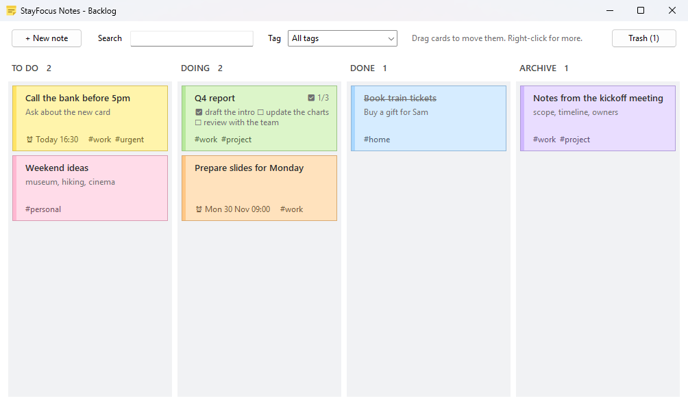
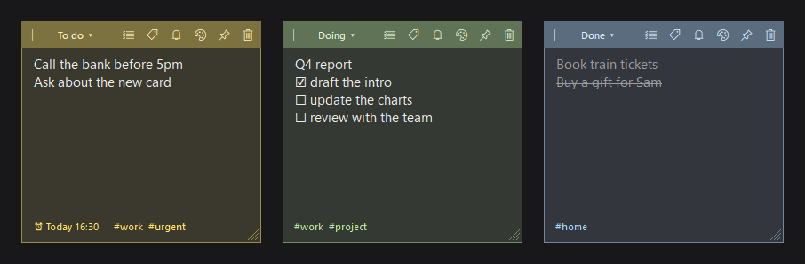

# StayFocus Notes

Sticky notes for the Windows desktop that appear and disappear with one keyboard shortcut, with a backlog board and tags to keep track of what you are doing.


- **One shortcut to show or hide every note** — `Ctrl+Alt+N`
- **Backlog board** — all notes in four columns: To do, Doing, Done, Archive
- **Checklists** — turn the lines of a note into check boxes and tick them off
- **Tags** — label notes, filter the board by tag
- **Reminders** — a note comes forward and blinks at the time you chose
- **Quick search** — `Ctrl+Alt+F` from anywhere, type a few letters, Enter opens the note
- **Trash and daily backups** — a deleted note can be restored for 30 days; the last 14 days of notes are kept
- **Light and dark theme** — follows Windows, or pick one
- **Private by design** — no internet access, no account, no telemetry; notes stay in one file on your PC
- **Small** — a single ~150 KB program, nothing to install, no administrator rights





## Install

Requires Windows 10 or 11.

1. Download `StayFocusNotes.zip` from the [latest release](https://github.com/mfessalifi/stayfocus/releases/latest).
2. Unzip it and put `StayFocusNotes.exe` in a folder of your own, for example `Documents\StayFocusNotes`.
3. Double-click `StayFocusNotes.exe`. A welcome note appears and a note icon is added to the tray (bottom-right of the taskbar).

**Windows may warn "Windows protected your PC"** the first time. This happens because the program is not signed with a commercial certificate. Choose **More info → Run anyway**, or [build it yourself](#build-from-source) from the source in this repository. Each release is built by GitHub from this source, and comes with a `SHA256SUMS.txt` file you can check the download against:

```powershell
Get-FileHash StayFocusNotes.zip -Algorithm SHA256
```

To start it automatically when you sign in, right-click the tray icon and tick **Start with Windows**.

## Use

| Action | How |
|---|---|
| Show / hide all notes | `Ctrl+Alt+N`, or click the tray icon |
| New note | `Ctrl+Alt+Shift+N`, or the `+` on any note |
| Open the backlog board | `Ctrl+Alt+B` |
| Move a note | drag its top bar |
| Resize a note | drag an edge or the bottom-right corner |
| Change status | the `To do ▾` button on the note, or drag its card to another column on the board |
| Checklist | the list button on the note, or `Ctrl+L` — see [Checklists](#checklists) |
| Tags | the tag button on the note, or right-click a card on the board |
| Search your notes | `Ctrl+Alt+F` — see [Quick search](#quick-search) |
| Reminder | the bell button on the note, or right-click a card on the board — see [Reminders](#reminders) |
| Color, always on top | the buttons on the right of the note's top bar |
| Delete | the bin button on the note; the note goes to the [trash](#trash-and-backups) |

Notes save automatically as you type.

### Status

- **To do / Doing** — normal notes on your desktop.
- **Done** — stays on the desktop with its text struck through.
- **Archive** — leaves the desktop and is kept on the board only. Move it to another column to bring it back.

### Checklists

A note can hold a to-do list: any line can start with a check box.

| Action | How |
|---|---|
| Add or remove a box on the current line (or every selected line) | the list button on the note, or `Ctrl+L` |
| Tick / untick | click the box, or `Ctrl+Enter` on its line |
| Next item | `Enter` at the end of an item |
| End the list | `Enter` on an empty item |
| Type a box by hand | `[ ]` or `[x]` followed by a space at the start of a line |

The board shows each note's progress, for example `2/5`. Boxes are ordinary characters (☐ ☑), so a checklist stays readable in the notes file and can be copied anywhere as text.

### Tags

A tag is one word (letters, digits and `- _ . / +`, up to 24 characters); a note can have up to 12. Tags ignore upper and lower case, so `Work` and `work` are the same tag. On the board, pick a tag in the **Tag** list to see only those notes; the search box also finds tag names.

### Reminders

Click the bell on a note and choose a time: in 15 minutes, in 1 hour, tomorrow at 09:00, next Monday, or any day and time. The time is shown at the bottom of the note and on its card.

When the time comes, the note appears on top of your other windows (even if notes are hidden or the note is archived), its top bar blinks for a few seconds, and the tray shows a message. The reminder then reads **Due** in red until you click it and either pick a later time or remove it. A reminder that came due while the PC was off is shown the next time the app starts.

### Quick search

Press `Ctrl+Alt+F` in any program. Type a few letters: the list shows the notes that contain every word you typed, in their text or their tags (`work` and `#work` both find the tag). Use `Up` / `Down` to choose and `Enter` to open the note; `Esc` closes the search. Archived notes are included.

### Trash and backups

- **Trash** — deleting a note moves it to the trash. Open it from the **Trash** button on the board or from the tray menu to restore a note or delete it for good. Notes are removed from the trash after 30 days.
- **Backups** — the first time the app runs each day, it copies the notes file to `%APPDATA%\StayFocusNotes\backups`. The last 14 daily copies are kept. **Backups...** in the tray menu lists them and restores the one you pick; your current notes are saved as one more backup first, so a restore can be undone.

### Tray menu

Right-click the tray icon for:

- **Search notes**, **Trash...**, **Backups...** — see above.
- **Shortcuts...** — change the four keyboard shortcuts (each needs two of Ctrl / Alt / Shift plus a key).
- **Theme** — Same as Windows (the default), Light or Dark.
- **Start with Windows**
- **Hide from screen capture** — notes and the board stay visible to you but do not appear in screenshots, recordings or screen sharing.
- **Exit**

## Your data and privacy

- Notes are stored in one readable file: `%APPDATA%\StayFocusNotes\notes.json`. Copy it to another PC to move your notes.
- The `backups` folder next to it holds the daily copies. They are on the same disk, so they protect against mistakes and a damaged file, not against losing the PC.
- To keep the file somewhere else, set the environment variable `STAYFOCUS_DATA_DIR` to a folder before starting the app.
- The app never connects to the internet and sends nothing anywhere.
- Shortcuts use the standard Windows hotkey feature: the app is told only when its own shortcuts are pressed and does not see anything else you type.
- Notes are **not encrypted**. Any program running under your Windows account can read them, so do not keep passwords in notes.

## Uninstall

1. Right-click the tray icon, untick **Start with Windows**, then choose **Exit**.
2. Delete `StayFocusNotes.exe`.
3. To also remove your notes, delete the folder `%APPDATA%\StayFocusNotes`.

## Build from source

Nothing to install: the scripts use the C# compiler that ships with Windows.

```powershell
git clone https://github.com/mfessalifi/stayfocus.git
cd stayfocus
powershell -ExecutionPolicy Bypass -File build.ps1      # creates bin\StayFocusNotes.exe
```

`install.ps1` builds and then copies the app to `%LOCALAPPDATA%\Programs\StayFocusNotes` (a folder only your account can change) and starts it. Run it again to update. With `-Sign` it also signs the exe with a self-signed certificate created on your PC; read the comments at the top of the script before using that option.

The code is in [src/](src/): plain C# and Windows Forms, no third-party libraries.

## Contributing

Bug reports and ideas are welcome in [Issues](https://github.com/mfessalifi/stayfocus/issues). For a security problem, please describe the impact and how to reproduce it.

## License

[MIT](LICENSE) — free to use, change and share.
